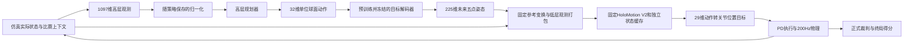
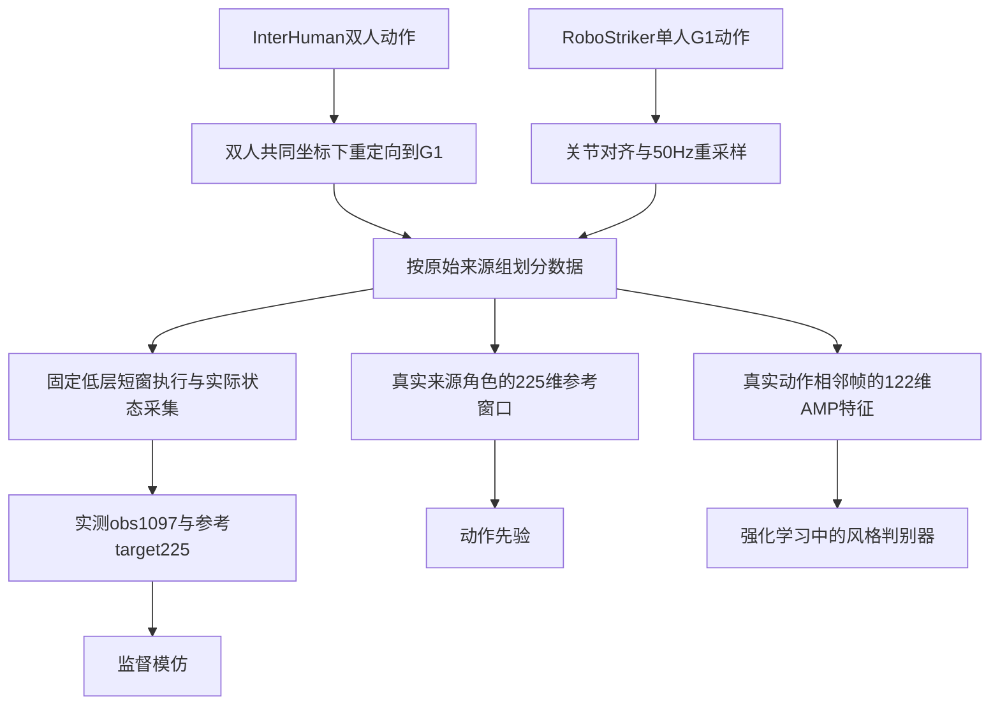

# HoloMotion 架构与仿真拳击得分目标梳理

分析日期：2026 年 10 月 28 日。范围：本地 `HoloMotion-master/HoloMotion-master` 源码快照。

项目目标明确为：**在固定 HoloMotion V2 低层控制器及比赛接口约束下，通过高层拳击策略最大化仿真比赛的正式得分。** 动作重建误差、模仿损失和 PPO 训练奖励是中间指标，不能代替裁判得分。

本轮完成静态架构、核心调用链、数据与训练流程分析；未启动数据采集仿真、训练、参数优化、模型下载或比赛评测。下文区分当前实现、由代码推导的影响和后续待验证事项。比赛数值按本地实现解释，不将源码快照等同于最新线上赛事规则。

## 目标与评价口径

设高层策略参数为 θ、固定低层控制器为 πL、评测对手集合为 P，主要目标可写为：

`最大化 J(θ) = E[正式裁判记录的己方最终得分 S_self(T)]，对手来自预先固定的 P，T 为实际终局时刻。`

评测还应同时报告分差、胜率、击倒对手率、自身被 KO 率、有效命中数量和异常终止比例。这些指标用于解释得分和排除单一对手上的偶然优势，不擅自将用户的“得分最大化”改成另一种目标。若后续采用平台排名汇总指标，应先确认其定义。

本地裁判的关键规则如下。

| 项目 | 当前实现 | 对策略分析的意义 |
| --- | --- | --- |
| 合法命中 | 手接触对手头部或躯干；踢击不计分 | 动作看起来像出拳并不代表得分 |
| 击打得分 | 20 ms 窗口累计法向冲量至少 5 N·s，每次 1 分 | 必须形成实际有效接触，不能用峰值力或手速替代 |
| 重复命中 | 每只手独立 200 ms 冷却，计分消耗冲量累计，不要求先分离 | 计分次数受冷却和冲量重建共同约束 |
| 倒地 | pelvis 或 torso 的 body origin 严格低于地面上方 0.30 m | 单纯倾斜不直接等于倒地 |
| KO | 持续倒地 3 s，给对手增加 1000 分并结束回合 | KO 对原始得分的贡献远大于单次命中，稳定性影响可获得的回合收益 |
| 回合与胜负 | 最多 60 s；单方 KO 时对方胜；双方记录的倒地起始时间相同且均连续倒地达到 3 s 时判双 KO 平局；超时比较总分 | 若倒地起始时间不同，即使在同一观察帧均达到确认期限，仍优先处理较早倒地者，不能按数组顺序判胜 |

裁判主线位于 [rules.py][rules]、[impulse_hit_rules.py][impulse] 和 [gpu_referee.py][referee]。仓库保留的力阈值、速度门限辅助代码不能直接解释为当前正式命中规则。

## 项目架构与任务边界

| 模块 | 主要职责 | 与本目标的关系 |
| --- | --- | --- |
| `holosmpl/` | 将多源人体动作统一为 50 Hz HoloSMPL，维护来源、坐标与数据格式 | 通用人体动作入口；拳击数据还有专用入口 |
| `holoretarget/` | 将人体运动映射为 G1 根位姿和 29 个关节位置 | InterHuman 等人体数据转机器人参考动作时使用 |
| `holomotion/src/motion_tracking/` | 共享 FK、坐标变换、参考观测、稀疏控制点 mask 与观测打包 | 保证参考目标和低层控制器之间的语义一致 |
| `holomotion/src/modules/` 与 `src/algo/` | MoE Transformer、PPO／PPOTF、SuperMimic 等通用动作跟踪模型和训练算法 | 解释固定低层能力的来源；本目标不需要重新训练这些模型 |
| `holoboxing/data/` | 拳击动作选择、重定向、分组划分、固定低层实测状态采集、AMP 数据 | 高层学习的数据基础 |
| `holoboxing/training/` | 参考动作先验、监督模仿、PPO＋AMP、站立预热、历史策略池自博弈、导出 | 后续高层策略研究的主体 |
| `holoboxing/evaluation/` | ONNX 契约检查、固定控制器接入、比赛物理、裁判、回放与时延资格检查 | 最终得分的判断依据 |
| `deployment/` | ROS2、遥操作、真机执行 | 属于完整项目架构，本轮仿真拳击分析无需进入真机流程 |

通用数据路线是“人体数据 → HoloSMPL → HoloRetarget → robot H5 → 动作跟踪模型”。拳击主线复用已经发布的跟踪模型，在其上训练决策层，不能将两个 PPO 训练系统混为一谈。

通用低层训练入口 [holomotion train.py][motion-train] 用 Hydra 配置实例化算法后调用 `load()`、`learn()`；V2 配方选择 PPOTF、link observation 和参考条件 MoE Transformer。核心网络是 [ReferenceRoutedGroupedMoETransformerPolicy][motion-network]，参考表示由 [link_observation.py][link-observation] 等共享模块处理。当前源码训练配方描述的架构不构成对已发布 ONNX 全部内部结构的实物验证；拳击运行时以固定 bundle 的配置、元数据和 hash 为准。

## 高层与固定低层如何协作

图中 32 维动作与冻结解码器对应教程的 sphere32 主线；比赛接口只要求最终 225 维目标，不规定参赛高层必须采用这种内部结构。

### 接口和坐标系

| 层级 | 接口 | 含义 |
| --- | --- | --- |
| 高层输入 | `obs: float32[1,1097]` | 10 帧自身状态 `10×108`，对手五点位置 15，剩余秒数 1，己方减对方分数 1 |
| 单帧自身状态 | 108 维 | pelvis 角速度 3，五点姿态 45，五点线速度 15，前一实测五点姿态 45 |
| 高层输出 | `target_pose: float32[1,225]` | `5 个未来时刻 × 5 个身体点 × 9 个姿态值` |
| 身体点顺序 | pelvis、左腕、右腕、左踝、右踝 | 对应固定 link 名称顺序 |
| 每点姿态 | `px,py,pz,Xx,Xy,Xz,Zx,Zy,Zz` | 米制位置和旋转矩阵 X／Z 两列；`Y=Z×X` |
| 预测时域 | 未来第 1 至第 5 帧 | 控制频率 50 Hz，对应 20、40、60、80、100 ms |
| 低层适配 | 逻辑语义为 `225 → reference655 → obs1378` | 固定参考特征、mask、机器人反馈和历史动作共同构成低层输入；compiled 路径可融合转换，不一定显式生成 655 维中间张量 |
| 低层输出 | 29 维动作 | `q_target = q_default + action_scale × action`，随后按关节名称映射到物理执行器 |

自身历史的位置、姿态和线速度重表达在**当前 yaw heading 坐标系 H**；历史角速度保留其采样时 body 坐标语义。对手位置和未来输出目标使用**当前 pelvis 完整三维坐标系 P**。不能把 H 和 P 混用，也不能把 X／Z 旋转列顺序套成其他库常见的 X／Y 表示。前一姿态 45 维来自实际测量，不是上一次高层动作。相关定义见 [CompetitionHistory][history]、[representation.py][representation]、[model_contract.py][contract]。

每个 20 ms 控制周期，高层根据当前观测重新生成整个未来目标窗；固定低层利用全部五帧目标计算当前关节动作；物理执行四个 5 ms 子步。它是持续反馈的滚动控制过程，不是输出五帧后开环等待 100 ms。

### 两种冻结对象与仍然变化的运行状态

必须区分“比赛指定低层”与“教程的动作解码器”。低层在整个拳击工作流中固定；解码器先在 prior 阶段学习，再在教程 SL／RL 阶段冻结。高层规划器在 SL／RL 阶段学习。

固定低层由 [frozen-model.json][frozen] 锁定到 `2.0_link_10500` 及对应配置／ONNX 的 SHA256。这里的禁止改动包括其参数和固定执行契约，不能靠替换控制器、改 action scale 或 PD 设置提高候选成绩。

**冻结参数不等于没有状态。** 每位拳手分别维护低层 KV cache、步号和上一动作；缓存形状为 `[1,2,1,32,4,64]`，按固定 32 步上下文机制重置，回合 reset 也清理状态。高层有独立十帧观测历史，reset 时重复首帧填满。双方不能共享缓存。见 [lower.py][lower]。

正式调用链为 `python -m holoboxing → evaluation.cli → match.evaluate_match → install_runtime → run_match`。`install_runtime` 根据已验证 compiled bundle 是否存在选择 `lean_runtime` 或源码 `fast_runtime`；正式路径有 GPU 常驻的观测和控制实现，因此不能仅根据 `upper.py` 中基础适配器的 CPU 描述判断最终性能。见 [match.py][match]、[holomotion_v2_runtime.py][runtime]。

### 默认参考策略实际使用的信息

当前球面策略的网络接口仍是 1097 维，但 `ActorNormalizer` 把最后两维时间和分差置零；新建 `SphericalActor` 的 `current_state` 模式又屏蔽前九帧历史以及当前记录中的前一实测姿态。因此它实际依赖当前自身 63 维和当前对手位置 15 维，共 78 个有效输入维度；其 MLP 张量宽度仍是 `1095→32`。

这意味着默认参考模型没有直接利用赛况进行领先防守／落后追分，也没有用完整历史估计对手运动。它是当前实现的能力边界，尚不能凭静态阅读认定为性能瓶颈。若未来研究这些信息，必须让数据、SL、RL、normalizer、checkpoint spec 和 ONNX 导出保持一致。本轮不修改这一设计。见 [spherical_actor.py][spherical]、[normalization.py][normalization]。

## 数据准备与三类学习数据

| 数据类型 | 来源与处理 | 使用方式 |
| --- | --- | --- |
| InterHuman | 双人动作重定向，保留共同世界坐标和相对位置，重采样到 50 Hz | 双人交互监督、prior、AMP |
| RoboStriker | 单人 G1 轨迹，按名字对齐 29 关节，重采样，至少六帧 | prior 与 AMP；采集时可配合成站立对手 |
| prior windows | 原始真实角色未来 `+1…+5` 帧姿态，每个角色产生 `N−5` 个窗口 | 仅学习参考目标表示，无状态观测、无合成对手样本 |
| measured records | `obs[N,1097]`、`target_pose[N,225]`、窗口与来源索引 | 当前参考 SL 硬性选择 InterHuman，不能只靠 RoboStriker 完成 |
| AMP transitions | 每帧 `角速度3+关节位置29+关节速度29=61`，相邻两帧拼成 122 | 训练动作风格判别器；不等于击打得分标签 |
| robot H5 | 根位置、根旋转 `xyzw`、29 关节位置 | 通用动作跟踪兼容产物；生成它不意味着需要重训低层 |

InterHuman 采用共同 XY 变换和成对高度比例处理，避免把两人分别重定向后破坏接触距离；不同阶段存在 `wxyz`／`xyzw` 顺序差异，需要遵循字段名。见 [interhuman.py][interhuman]、[records.py][records]。

**`holoboxing.data prepare` 含物理仿真采集，不是单纯离线文件转换。** `MeasuredCollector` 让固定低层实际跟踪参考，采集机器人执行后的状态，标签仍来自未来参考轨迹；共同 XY 位移修正后再把标签变换到实际当前 pelvis 坐标系。核心采集窗为 100 帧、最多预热 10 帧；发生倒地则截断，并剔除跨越失败点的未来标签。见 [collection.py][collection]。这一机制缓解参考状态与控制器实际状态之间的差异，但不能证明高层闭环长时间对抗稳定。

来源组先划分再做镜像增强；原始片段与镜像共享 group。官方 split 优先，其他来源用确定性 group split。普通 prepared 排除 test；prior 准备可以保留 test shard，但训练和模型选择读取 train／validation。prior 与 SL 默认 test fraction 不同，后续必须统一记录分组方案。模型加载会检查 prior 训练组是否泄漏到 SL 验证组。

数据产物包括 `sources.json`、`prepared/manifest.json`、clip NPZ、兼容 H5 和 `COMPLETE.json`；manifest 记录样本数、来源分组、hash、机器人资源身份。准备过程中保存覆盖率、拒绝样本和跌倒截断等信息。来源／资产一致性检查是必要条件，并不能替代正式规则下的行为评测。见 [prepare.py][prepare]、[prior_data.py][prior-data]。

## 动作先验阶段

先验实现是确定性球面自编码器：

`参考目标225 → 训练集统计标准化 → MLP编码器 → 单位向量z∈R32 → MLP解码器 → 反标准化225 → X/Z正交投影`。

它没有 VAE 的 KL 项，也不是根据对手状态选择动作的拳击策略。当前 `train_prior` 采用标准化重建 MSE：`mean(((预测目标−参考目标)/scale)^2)`；代码中 `uniformity_weight=0`，不能把它说成已施加球面均匀分布约束。

该阶段训练 encoder 和 decoder，保存 `best.pt`、`last.pt`、`metrics.jsonl`，以及统计量、来源组、资产身份、优化器、RNG、恢复位置。验证／先验选择使用参考重建误差和物理单位误差；测试入口的评估范围也是离线重建。见 [motion_prior.py][prior]、[train_prior.py][train-prior]。

低重建误差说明真实参考目标能被压缩和恢复，不说明任意潜变量、潜变量跳变或对抗接触下的动作都能由固定低层稳定执行。prior 阶段不应承担最终拳击成绩的判断。

## 监督学习阶段

教程主线将冻结的 decoder 放在规划器后面：

`实际执行状态与对手位置 → ActorNormalizer → latent_policy → unit_vector → frozen MotionDecoder → 225维目标`。

SL 在训练集上拟合归一化和损失统计量，验证集不参与拟合。损失是 `0.5×位置标准化MSE + 0.5×X/Z旋转标准化MSE`，在最终目标空间监督；不是用 prior encoder 的 latent 作为直接教师标签，也没有对比赛得分或物理 rollout 反向传播。只有 `requires_grad=True` 的规划器参数参与该分支优化。

检查点保存高层权重、冻结 decoder、normalizer、损失统计、policy spec、来源契约和优化器／恢复 cursor。decoder hash 会被复核。SL 解决的是“控制器实际状态下如何预测参考动作”，还未直接学习“怎样击败对手”。见 [supervised training.py][sl-training]、[statistics.py][sl-statistics]。

仓库另有可选的 `JointActor` 路线：不传 `--prior-checkpoint` 时，`task123→32` 与 `history1080→32` 合成潜变量，再由 `current108+latent32` 生成 225 维残差。这个分支的 decoder 可训练，内部名为 `prior` 的 history MLP 也不是上文预训练自编码器。因此“冻结动作解码器”只应归属于教程 sphere32 路线；“固定比赛低层”则是两条高层路线都必须遵守的约束。见 [actor_critic.py][actor-critic]。

## 强化学习与自博弈阶段

入口 `train_rl.py` 进入 `scripts/train_mujoco.py`，构造 `MujocoSandbagEnv`、actor／critic、AMP、PPO 和 `OnPolicyRunner`。MuJoCo／Warp 并行采集实际轨迹，固定低层执行高层参考；梯度通过 PPO 更新高层网络，不通过物理引擎或固定低层。

### PPO 的动作与冻结边界

球面路线的 PPO 动作空间是 **32 维投影前随机向量**。存入 rollout buffer 的是采样原向量及其 Gaussian log probability；执行时归一化到球面，再由冻结 decoder 输出 225 维目标。不能把归一化后的向量代入原 Gaussian 概率计算，也不能将配置中的外部目标维度 225 误认为该路线的随机动作维度。见 [spherical_rl.py][spherical-rl]。

| 对象 | SL 主线 | RL 主线 |
| --- | --- | --- |
| 比赛 HoloMotion 低层 | 固定 | 固定，独立维护执行状态 |
| prior decoder | 固定并校验 hash | 固定并校验 hash |
| 高层 planner | 学习 | 学习 |
| actor normalizer | 训练集拟合后使用固定统计量 | learner 的统计量可继续在线更新 |
| critic 与探索分布 | 不用于监督推理产物 | 按有效角色学习 |
| AMP 判别器 | 不参与 SL | 学习；其输入统计量由示范数据拟合后固定 |
| 自博弈对手 | 不适用 | 快照权重与对应 normalizer 一起冻结 |

### 训练奖励与正式得分的差距

PPO 训练采用任务塑形奖励与 AMP 风格奖励混合。AMP 以 prepared 数据 train split 的真实动作相邻帧为示范，可包含 InterHuman 和 RoboStriker；以策略实际执行状态为负样本，鼓励动作风格接近参考数据。standing／selfplay 仅将学习方的有效 transition 纳入负样本，冻结对手不参与更新。AMP 不是裁判或合法命中判别器。

任务奖励包含接近、朝向、击打、平衡、站立等项，进攻项使用腕部／躯干接触力及相对拳速等代理信号。正式裁判则基于**手对头／躯干的法向冲量窗口与冷却**累计分数。当前训练环境没有把正式命中分数和 KO 1000 分作为同一套逐步奖励传入 PPO。

默认配置以 `0.8×task_reward + 0.2×style_reward` 混合，但 task 项另有权重和控制步长缩放，style 项另有 discriminator scale；系数 0.8／0.2 不能解释成实际收益贡献固定为 80%／20%。

训练环境复用了部分比赛时长与倒地终止设置，但还存在连续接触约 5 s 的提前结束条件；输入末尾比赛时间／分差置零。不同终止边界也会改变可学习的长期交互。结论是：**训练回报增加可以说明代理任务学得更好，不能证明正式拳击得分提高。** 未来首先要检查奖励、接触证据和终止规则是否与目标一致，再讨论参数优化。见 [mujoco_rewards.py][rewards]、[combat rewards.py][combat-rewards]、[mujoco_env.py][boxing-env]。

训练还包含初始状态扰动及随机 push；这些用于训练分布，不能把其结果直接当作比赛固定初始站位下的成绩。

### 三种对手模式

| 模式 | 对手与更新方式 | 定位 |
| --- | --- | --- |
| `standing` | 对手按回合 reset 时确定的世界坐标目标站立；目标不随受击位移重新居中；仅有效进攻角色更新 | 教程的站立对手预热 |
| `selfplay` | 从冻结的历史策略及归一化快照池取对手；训练 learner，定期产生新快照 | 对抗历史策略，扩展训练分布 |
| `paired` | learner 与另一角色共同训练，但另一角色主要学习站立／平衡 | CLI 默认的角色配对模式，不等于双方对称拳击自博弈 |

对手池保存初始策略和近期快照，均匀抽样；没有实现基于 Elo 的联盟、胜率优先对手采样或自动难度晋级。容量默认 8；刷新间隔 CLI 默认 256 次更新，教程 selfplay 示例显式使用 128，因此必须区分默认值和示例覆盖。刷新发生在更新边界，并重置物理回合与历史。教程的 `24步/更新 × 0.02秒/步 × 128更新 = 61.44秒` 是两次强制刷新之间的名义模拟时间，实际回合仍可能因其他终止条件提前结束。

**教程 selfplay 总预算也是 128 次更新，刷新间隔等于训练长度，所以这一示例实际只面对预热模型的一个冻结副本。** 延长训练后才会实际切换历史对手。CLI 默认预算为 40,000 次更新，基础配置为 4,096 个环境；教程则显式覆盖为 128 个环境、standing 32 次更新、selfplay 128 次更新，每次更新每环境采集 24 步。这些是已有配置记录，不是本轮调参建议。

`WorldStandingReference` 固定的是世界目标，不只是重复一个 latent；受力后机器人是否仍稳定站立需要仿真验证。自博弈快照冻结的是策略和统计量，不能只复制权重而让对手 normalizer 继续变化。实现见 [standing_reference.py][standing]、[opponent_pool.py][pool]、[on_policy_runner.py][runner]。

教程推荐流程是 SL → standing 预热 → selfplay；各阶段通过 checkpoint 手动衔接，并非已有一个根据正式得分自动晋级的流程。`--policy-checkpoint` 用于开始新的课程阶段，复用 ego actor 和归一化统计，重新建立 critic、optimizer、探索状态与对手池；`--resume` 用于恢复兼容的原训练状态，不能任意切换训练模式。resume 恢复学习状态后，物理与观测历史重新开始，不能解释为比赛现场的连续恢复。

RL 产物包括 `model_*.pt`、`training-result.json` 和完成记录。`complete.json` 明确标记 `boxing_quality_verified: false`：完成迭代只是流程完成，拳击质量需要额外对局验证。

## 导出与得分验证闭环

`export.py` 将高层 planner、所需 decoder 与 fitted normalizer 组合为单个 ONNX；低层大模型不打包进参赛文件。球面路线导出确定性的 planner 输出，不携带训练时的探索随机采样。

导出会检查有限数值、输入输出契约、文件大小与 PyTorch／ONNX CPU 输出一致性，包含位置和旋转误差。这只是导出验证，不能证明 GPU 时延合格或比赛表现良好。正式比赛入口使用两个符合接口的高层 ONNX，双方复用指定低层，生成 `match.json` 和 `replay.hdf5`。见 [export.py][export]、[validation.py][validation]、[match.py][match]。

| 验证层次 | 要回答的问题 | 不应得出的结论 |
| --- | --- | --- |
| 静态契约 | 是否自包含、严格小于 50,000,000 bytes、输入输出正确、无不允许的随机图运算 | 不能推断机器人站得住 |
| 数值一致性 | PyTorch 与 ONNX 是否输出相同语义的目标，旋转轴是否合法 | 不能推断正式性能合格 |
| 单人全链路时延 | 高层观测／推理／解码／低层观测／推理／缓存／关节目标转换是否满足资格门槛 | 不等于完整双人比赛的物理 FPS |
| 正式仿真对局 | 得分、KO、胜负、异常与回放是否支持改进 | 不等于泛化到全部对手 |
| 固定对手集和双方位置评测 | 改进是否覆盖不同打法与红蓝位置 | 不能以同一确定性对局的重复次数充当独立样本量 |

`evaluate_native.py` 可接入冻结的原生 RoboStriker 对手，复用比赛场地和裁判，但对手的原生控制接口与参赛高层接口不同。它适合训练研究对照，候选模型仍需单独通过未修改的标准评测路径。

### 时延文档与代码存在冲突

README 描述单人全链路平均时延 ≤10 ms；**当前实际资格路径使用 ≤5 ms**：`validation.py → chain_benchmark.py → qualification.py`，两个检查点均按 5 ms 判定。默认预热 10 步、测量 100 步；5 ms 换算为该链路吞吐指标是 200 FPS，并不把控制频率从 50 Hz 改成 200 Hz。

计时范围包含高低层适配和缓存更新，排除物理推进及输出 sanitation；完整双人控制循环另有 20 ms 预算诊断。`benchmark.py` 的 10 ms 参数不是这里的单人正式资格阈值。当前源码测试也锁定了 5 ms 边界。后续应先核对所用发布镜像和赛事要求的一致性，本轮不擅自修改任一阈值。见 [chain_benchmark.py][chain-benchmark]、[qualification.py][qualification]。

## 当前源码包的可运行条件

本地实际源码根目录比用户给定目录多一层 `HoloMotion-master`，且未包含 `.git`，不能给出可核验的提交号或以 Git diff 证明版本来源。

目录检查显示 `thirdparties/` 各子模块目录为空，`holoboxing/assets` 是内容指向 `../thirdparties/HoloMotion_assets/holoboxing` 的普通文本占位，而非可用资源目录。此源码根内未发现 ONNX、PT／PTH 或 H5／HDF5 模型与训练数据；只检出一份动作重定向示例 NPZ。该结论仅针对本次源码目录，不代表用户电脑其他位置没有资源。

因此当前已确认的是代码实现和静态数据契约。固定模型字节、训练数据覆盖、CUDA 环境、生成的 compiled bundle、运行时数值／速度和比赛成绩都尚未验证。源码 fallback 与发布镜像的 compiled 路径也不能未经比较视为同一套性能结果。

## 后续工作顺序与本轮交付边界

| 顺序 | 后续应解决的事项 | 判断依据 |
| --- | --- | --- |
| 1 | 固定评测版本、模型／资源 hash、计分规则和时延口径 | 排除环境或规则变化造成的成绩差异 |
| 2 | 定义固定对手集合、双方位置及正式得分记录方式 | 明确“最大化得分”的可比较目标 |
| 3 | 核对实测数据、split、坐标、冻结控制器和标签一致性 | 确保学习样本确实对应可执行控制链 |
| 4 | 检查训练塑形奖励、AMP 与正式计分／终止规则的关系 | 降低代理奖励与真正目标不一致的风险 |
| 5 | 建立 prior、SL、standing、自博弈各阶段的独立验收记录 | 不用上一阶段的低误差替代下一阶段的行为证据 |
| 6 | 再评估是否使用历史、比赛时间／分差，以及是否改进对手选择 | 将架构假设转成可单独验证的研究问题 |
| 7 | 最后才开展高层训练和模型／训练参数实验 | 使用正式得分及辅助指标选择方案 |

以上是后续工作排序，本轮没有实施训练、调参或运行验证。当前交付为这份架构和代码梳理文档，不包含新模型或仿真得分结果。

## 核心代码阅读索引

建议先读比赛接口与裁判，再读球面 actor 和固定低层适配，最后沿数据、prior、SL、RL、导出顺序跟踪产物。

| 问题 | 核心代码入口 |
| --- | --- |
| 输入输出是否合规 | [model_contract.py][contract]、[CompetitionHistory][history] |
| 225 维目标如何执行 | [lower.py][lower]、[运行时安装][runtime] |
| 击打和 KO 如何计分 | [impulse_hit_rules.py][impulse]、[MatchStateMachine][rules] |
| 数据是否来自实际执行 | [MeasuredCollector][collection]、[数据准备][prepare] |
| 先验究竟学什么 | [MotionPrior][prior]、[train_prior][train-prior] |
| 高层哪些信息被使用 | [SphericalActor][spherical]、[ActorNormalizer][normalization] |
| SL 哪些参数被训练 | [监督训练][sl-training]、[损失统计][sl-statistics] |
| PPO 优化什么动作和奖励 | [SphericalActorCritic][spherical-rl]、[训练奖励][rewards] |
| 自博弈如何切换对手 | [OpponentPool][pool]、[OnPolicyRunner][runner] |
| 怎样形成提交与成绩 | [export_policy][export]、[evaluate_match][match] |
| 时延门槛实际由谁决定 | [measure_chain][chain-benchmark]、[qualification][qualification] |

[contract]: C:/Users/XJTU/Desktop/HBot/HoloMotion-master/HoloMotion-master/holoboxing/evaluation/runtime/model_contract.py:6
[history]: C:/Users/XJTU/Desktop/HBot/HoloMotion-master/HoloMotion-master/holoboxing/data/contract.py:66
[representation]: C:/Users/XJTU/Desktop/HBot/HoloMotion-master/HoloMotion-master/holoboxing/evaluation/runtime/representation.py
[rules]: C:/Users/XJTU/Desktop/HBot/HoloMotion-master/HoloMotion-master/holoboxing/evaluation/runtime/rules.py:288
[impulse]: C:/Users/XJTU/Desktop/HBot/HoloMotion-master/HoloMotion-master/holoboxing/evaluation/runtime/impulse_hit_rules.py:8
[referee]: C:/Users/XJTU/Desktop/HBot/HoloMotion-master/HoloMotion-master/holoboxing/evaluation/runtime/gpu_referee.py
[motion-train]: C:/Users/XJTU/Desktop/HBot/HoloMotion-master/HoloMotion-master/holomotion/src/training/train.py:104
[motion-network]: C:/Users/XJTU/Desktop/HBot/HoloMotion-master/HoloMotion-master/holomotion/src/modules/network_modules.py:2209
[link-observation]: C:/Users/XJTU/Desktop/HBot/HoloMotion-master/HoloMotion-master/holomotion/src/motion_tracking/link_observation.py:274
[frozen]: C:/Users/XJTU/Desktop/HBot/HoloMotion-master/HoloMotion-master/holoboxing/evaluation/frozen-model.json:1
[lower]: C:/Users/XJTU/Desktop/HBot/HoloMotion-master/HoloMotion-master/holoboxing/evaluation/runtime/lower.py:86
[match]: C:/Users/XJTU/Desktop/HBot/HoloMotion-master/HoloMotion-master/holoboxing/evaluation/match.py:12
[runtime]: C:/Users/XJTU/Desktop/HBot/HoloMotion-master/HoloMotion-master/holoboxing/evaluation/runtime/holomotion_v2_runtime.py:8
[spherical]: C:/Users/XJTU/Desktop/HBot/HoloMotion-master/HoloMotion-master/holoboxing/training/spherical_actor.py:24
[normalization]: C:/Users/XJTU/Desktop/HBot/HoloMotion-master/HoloMotion-master/holoboxing/training/rsl_rl/modules/normalization.py:30
[interhuman]: C:/Users/XJTU/Desktop/HBot/HoloMotion-master/HoloMotion-master/holoboxing/data/interhuman.py:231
[records]: C:/Users/XJTU/Desktop/HBot/HoloMotion-master/HoloMotion-master/holoboxing/data/records.py:325
[collection]: C:/Users/XJTU/Desktop/HBot/HoloMotion-master/HoloMotion-master/holoboxing/data/collection.py:267
[prepare]: C:/Users/XJTU/Desktop/HBot/HoloMotion-master/HoloMotion-master/holoboxing/data/prepare.py:538
[prior-data]: C:/Users/XJTU/Desktop/HBot/HoloMotion-master/HoloMotion-master/holoboxing/training/prior_data.py:13
[prior]: C:/Users/XJTU/Desktop/HBot/HoloMotion-master/HoloMotion-master/holoboxing/training/motion_prior.py:45
[train-prior]: C:/Users/XJTU/Desktop/HBot/HoloMotion-master/HoloMotion-master/holoboxing/training/train_prior.py:20
[sl-training]: C:/Users/XJTU/Desktop/HBot/HoloMotion-master/HoloMotion-master/holoboxing/training/supervised/training.py:261
[sl-statistics]: C:/Users/XJTU/Desktop/HBot/HoloMotion-master/HoloMotion-master/holoboxing/training/supervised/statistics.py:71
[actor-critic]: C:/Users/XJTU/Desktop/HBot/HoloMotion-master/HoloMotion-master/holoboxing/training/rsl_rl/modules/actor_critic.py:70
[spherical-rl]: C:/Users/XJTU/Desktop/HBot/HoloMotion-master/HoloMotion-master/holoboxing/training/spherical_rl.py:22
[rewards]: C:/Users/XJTU/Desktop/HBot/HoloMotion-master/HoloMotion-master/holoboxing/training/envs/mujoco_rewards.py:143
[combat-rewards]: C:/Users/XJTU/Desktop/HBot/HoloMotion-master/HoloMotion-master/holoboxing/training/tasks/combat/mdp/rewards.py:79
[boxing-env]: C:/Users/XJTU/Desktop/HBot/HoloMotion-master/HoloMotion-master/holoboxing/training/envs/mujoco_env.py:446
[standing]: C:/Users/XJTU/Desktop/HBot/HoloMotion-master/HoloMotion-master/holoboxing/training/standing_reference.py:9
[pool]: C:/Users/XJTU/Desktop/HBot/HoloMotion-master/HoloMotion-master/holoboxing/training/opponent_pool.py
[runner]: C:/Users/XJTU/Desktop/HBot/HoloMotion-master/HoloMotion-master/holoboxing/training/rsl_rl/runners/on_policy_runner.py
[export]: C:/Users/XJTU/Desktop/HBot/HoloMotion-master/HoloMotion-master/holoboxing/training/export.py:151
[validation]: C:/Users/XJTU/Desktop/HBot/HoloMotion-master/HoloMotion-master/holoboxing/evaluation/validation.py:17
[chain-benchmark]: C:/Users/XJTU/Desktop/HBot/HoloMotion-master/HoloMotion-master/holoboxing/evaluation/runtime/chain_benchmark.py:24
[qualification]: C:/Users/XJTU/Desktop/HBot/HoloMotion-master/HoloMotion-master/holoboxing/evaluation/qualification.py:15

