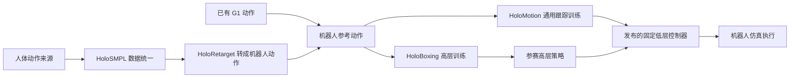
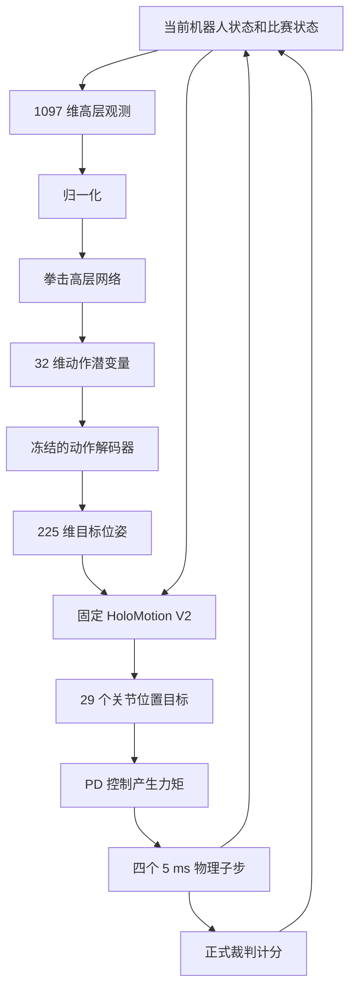

# HoloMotion 项目与核心代码入门报告

版本日期：2026 年 10 月 29 日。面向第一次接触本仓库、PyTorch 和机器人强化学习的读者。

HoloMotion 提供让机器人跟踪动作的通用能力；HoloBoxing 在这项能力之上学习拳击决策。我们当前的工作目标是：**使用固定的 HoloMotion V2 低层控制器，让自己训练的高层策略在仿真拳击比赛中取得更好的正式计分和胜负结果。** 首次参赛最终需要交付一个高层 ONNX 文件。

建议先读第 1—4 节建立整体认识，再沿第 5—8 节理解训练，最后阅读第 9—12 节了解评测、提交和改代码的方法。文中代码链接都相对仓库保存，换电脑或在 GitHub 上也能打开。简化伪代码用于讲解，完整启动命令见[拳击工作流](boxing_competition_workflow.zh-CN.md)。

## 1. 先分清仓库里的几套系统

| 目录 | 解决什么问题 | 关键入口 | 对当前拳击任务的作用 |
| --- | --- | --- | --- |
| `holosmpl/` | 将不同人体动作来源整理成统一数据格式 | [cli.py](../holosmpl/cli.py) | 使用人体动作数据时的前处理工具 |
| `holoretarget/` | 把人体动作转换成 G1 机器人能表达的姿态 | [online.py](../holoretarget/online.py) 的 `HoloRetargeter` | InterHuman 重定向、在线遥操作等流程共用 |
| `holomotion/` | 训练机器人全身动作跟踪控制器 | [training/train.py](../holomotion/src/training/train.py) | 提供拳击固定低层所依赖的控制能力及共享特征代码 |
| `holoboxing/data/` | 下载拳击动作、转换并采集训练数据 | [cli.py](../holoboxing/data/cli.py) | 为动作先验、监督学习和 AMP 提供输入 |
| `holoboxing/training/` | 训练拳击高层策略 | [train_prior.py](../holoboxing/training/train_prior.py)、[train_sl.py](../holoboxing/training/train_sl.py)、[train_rl.py](../holoboxing/training/train_rl.py) | 当前需要重点掌握的训练主线 |
| `holoboxing/evaluation/` | 加载参赛模型、运行对局、裁判计分和回放 | [cli.py](../holoboxing/evaluation/cli.py)、[match.py](../holoboxing/evaluation/match.py) | 判断模型是否可运行以及是否打得更好 |
| `deployment/` | 真机部署、ROS2 和遥操作 | [部署说明](realworld_deployment.md) | 仿真拳击参赛暂不需要启动 |
| `tests/` | 检查算法与接口行为是否符合预期 | [本轮规则测试](../tests/test_boxing_competition_workflow.py) | 发现程序错误；不能代替比赛结果 |
| `docs/` | 安装、训练、部署和分析说明 | 本报告及[拳击工作流](boxing_competition_workflow.zh-CN.md) | 查设计和操作步骤 |

`assets/` 和 `thirdparties/` 保存资源或第三方内容；`models/` 保存下载的模型；`results/` 保存实验产物。大型模型、原始动作数据、临时环境和实验输出通过 `.gitignore` 留在本机，不随当前代码提交上传。换电脑需要同步这些资源，或按照下载入口重新获取。

整个项目可以理解为下面两条相接的路径：



图中的低层发布模型已经存在。当前拳击路线直接使用它，不需要先从头训练通用 HoloMotion。

## 2. 理解一个控制周期

可以把高层看作“决定手脚接下来去哪里”的规划器，把低层看作“根据身体当前状态实现这些目标”的控制器。

假设对手在正前方，高层想出左拳。程序不会向 MuJoCo 发送字符串“左直拳”，而是产生一组数字，描述骨盆、手腕和脚踝在接下来五个时刻的位置与朝向。低层再根据这些目标和当前身体状态，计算 29 个关节的动作。



一个高层控制周期是 20 ms，即 50 Hz。期间运行四个 5 ms 的物理子步，即 200 Hz。每个控制周期都重新预测未来 20、40、60、80、100 ms 的目标，因此机器人会持续根据新观测修正动作。

这里有两个不同的冻结对象：

- **比赛固定低层**：已经发布的 HoloMotion V2 ONNX，整个拳击训练和评测过程保持固定。
- **动作解码器**：先在我们自己的动作先验阶段学习，随后在球面策略的 SL／RL 阶段冻结。

“冻结”只表示网络参数不更新。观测历史、低层缓存、上一动作等运行状态仍然会随时间变化，并在重置时处理。双方拳手必须维护各自的状态。

## 3. 看懂最重要的数字

### 3.1 高层为什么接收 1097 个数

`1097 = 10 × 108 + 15 + 2`。

| 部分 | 维度 | 内容 |
| --- | --- | --- |
| 自身十帧历史 | 1080 | 每帧 108 个数，记录自身运动状态 |
| 对手当前位置 | 15 | 对手五个身体点各有三个位置坐标 |
| 比赛上下文 | 2 | 剩余秒数、己方减对方的分差 |

单帧 108 维又是 `3 + 45 + 15 + 45`：骨盆角速度、当前五点位姿、五点线速度、前一次实测五点位姿。“前一次实测位姿”是机器人实际到达的位置，不是网络上次希望到达的位置。

接口提供十帧历史，不代表每个策略都使用全部历史。当前 `current_state` 球面策略会屏蔽旧帧和前一次姿态，只使用其中当前自身 63 维与对手 15 维；`history10` 方案保留已有历史。比赛上下文是否影响策略由 `--match-context` 控制。

### 3.2 高层为什么输出 225 个数

`225 = 5 个未来时刻 × 5 个身体点 × 9 个位姿值`。

五点顺序是骨盆、左腕、右腕、左踝、右踝。每一点包含三个位置值，以及旋转矩阵的 X、Z 两列共六个数。它不是九个角度，也不是 225 个关节。旋转投影代码会把网络输出整理为正交朝向。

坐标系也属于接口：自身历史采用当前 yaw heading 相关表示；对手位置和输出目标按当前骨盆完整姿态定义。直接把世界坐标拼入这些字段，会导致“数字维度正确，动作方向错误”。

定义优先查看 [model_contract.py](../holoboxing/evaluation/runtime/model_contract.py)、[representation.py](../holoboxing/evaluation/runtime/representation.py) 和 [geometry.py](../holoboxing/training/tasks/combat/mdp/geometry.py)。

### 3.3 32、29 和 batch 分别是什么

- `32`：教程球面高层内部的动作表示维度。它没有预先命名的“第 1 维控制左拳”等对应关系。
- `29`：G1 受控关节数量。最终由固定低层输出关节动作。
- `batch`：一次并行处理的样本数。训练中可有多个仿真世界；参赛 ONNX 的公开输入是单个样本 `[1,1097]`。

可以把 tensor 理解为有形状的多维数字数组。阅读代码时先追踪 `.shape`，通常比先理解每个数学公式更有效。

## 4. 从代码追踪一次动作

主线从 [train_rl.py](../holoboxing/training/train_rl.py) 解析命令行开始，进入 [scripts/train_mujoco.py](../holoboxing/training/scripts/train_mujoco.py) 的 `train()`，由它组装资源、环境、策略、示范数据和 runner。

| 文件与对象 | 主要职责 | 阅读时应追踪的输入与输出 |
| --- | --- | --- |
| [spherical_actor.py](../holoboxing/training/spherical_actor.py) `SphericalActor.latent()` | 按观测方案选取信息，产生单位球面潜变量 | 1097 维观测 → 32 维潜变量 |
| [motion_prior.py](../holoboxing/training/motion_prior.py) `MotionDecoder.forward()` | 将潜变量展开为五点未来目标 | 32 → 225 |
| [spherical_rl.py](../holoboxing/training/spherical_rl.py) `SphericalActorCritic` | 将球面策略接入 PPO 的采样和执行接口 | 策略分布、价值估计、解码后的动作 |
| [envs/mujoco_env.py](../holoboxing/training/envs/mujoco_env.py) `MujocoSandbagEnv.step()` | 执行动作、推进物理、算奖励、处理终止和新观测 | 双方动作 → 新观测、奖励、done、info |
| [envs/control.py](../holoboxing/training/envs/control.py) | 把高层目标转换为固定低层需要的参考与反馈 | 五点目标、当前状态 → 低层输入与关节目标 |
| [envs/onnx_lower.py](../holoboxing/training/envs/onnx_lower.py) `OnnxLower` | 运行指定低层 ONNX，支持训练批量执行 | 固定模型及其输入输出缓存 |
| [envs/mujoco_physics.py](../holoboxing/training/envs/mujoco_physics.py) `CompetitionPhysics` | 关节 PD、MuJoCo-Warp 步进与接触读取 | 关节目标 → 新物理状态和接触证据 |
| [envs/official_referee.py](../holoboxing/training/envs/official_referee.py) `OfficialReferees` | 把训练世界的子步证据交给共享裁判 | 接触、倒地、时钟 → 分数和终局 |

`step()` 可概括为下面的伪代码：

```python
joint_targets = fixed_lower(current_state, upper_targets)
for _ in range(4):
    physics.substep(joint_targets)
    referee.sample(physics.contacts())
result = referee.observe(current_positions, fallen_flags)
reward = official_net_score_increment + outcome_reward + auxiliary_rewards
if result.match_over:
    reset_that_world()
return observations, reward, done, information
```

实际代码还维护双方缓存、AMP 特征、训练扰动以及异常状态记录。新手第一遍只要追清楚“目标从哪里来、物理在哪里推进、奖励在哪里算、何时 reset”。

## 5. 数据准备为什么分成两条路径

### 5.1 参考动作数据

参考动作描述“希望机器人做什么”。[prepare_prior.py](../holoboxing/training/prepare_prior.py) 将来源动作转换成 225 维未来目标窗口，交给动作先验训练。该阶段不需要策略观测，也不需要先生成拳击胜负标签。

### 5.2 实测执行数据

[data/prepare.py](../holoboxing/data/prepare.py) 组织来源与分组，[data/collection.py](../holoboxing/data/collection.py) 的 `MeasuredCollector` 使用固定低层在物理环境中执行参考，记录机器人实际状态。输出含观测 `obs`、未来目标 `target_pose`、样本索引和来源信息。

参考轨迹与实测轨迹不完全相同：机器人可能落脚偏移、转身滞后或失去平衡。高层部署时看到的是实测状态，因此不能直接把“理想参考姿态”当作全部训练观测。这也是 `holoboxing.data prepare` 需要 GPU 仿真，而不是普通文件转换的原因。

| 数据来源／产物 | 主要用途 | 初学者容易混淆的地方 |
| --- | --- | --- |
| RoboStriker G1 动作 | prior、AMP；公开数据路线也可提供先验直接 RL 的观测统计 | 单人动作不是完整双人交互示范 |
| InterHuman 双人动作 | 经重定向后用于教程 SL、prior、AMP | 此路线需要额外的人体模型与转换准备 |
| `reference-*.npz` | 先验的参考目标窗口 | 不等同于可直接初始化 RL 统计量的实测数据 |
| `prepared/clip-*.npz` | 实测观测与目标、来源索引 | 必须与机器人和低层版本对应 |
| `sources.json`、`manifest.json` | 描述来源、分组、文件和样本数量 | 是数据说明与身份记录，不是模型权重 |
| `COMPLETE.json` | 标记完整的数据准备产物 | 只有部分 NPZ 文件不表示准备完成 |

训练集用于更新参数；验证集用于选择模型；测试集用于最终评价。同一原始片段及其镜像必须属于同一组、同一分区，否则容易把几乎相同的动作同时放进训练集和测试集。

## 6. 动作先验和监督学习各学什么

### 6.1 动作先验学习一种紧凑表示

[motion_prior.py](../holoboxing/training/motion_prior.py) 定义 `MotionPrior`：

```text
参考目标 225 → 标准化 → encoder → 单位球面向量 32
单位球面向量 32 → decoder → 反标准化与旋转投影 → 重建目标 225
```

训练时要求重建目标接近原目标。`encoder` 负责压缩，`decoder` 负责还原；`unit_vector()` 把潜变量长度规范为 1。此处是确定性自编码器，不应按 VAE 或扩散模型理解。

[train_prior.py](../holoboxing/training/train_prior.py) 负责优化、保存检查点和根据验证重建结果选出 `best.pt`。随后高层保留冻结 decoder，自行学习怎样选择潜变量。先验重建误差低，意味着参考动作能被较好表达；拳击胜率仍要由实战评价。

### 6.2 监督学习学习由状态预测参考动作

[train_sl.py](../holoboxing/training/train_sl.py) 进入 [supervised/training.py](../holoboxing/training/supervised/training.py)。核心流程是：

```text
实测自身状态与对手位置 → 高层网络 → 冻结 decoder → 预测目标
预测目标与示范目标比较 → 计算损失 → 更新高层网络
```

位置与旋转损失先按训练集统计标准化，再共同优化，避免不同物理量的数值尺度支配训练。训练集统计由 [statistics.py](../holoboxing/training/supervised/statistics.py) 拟合，验证集不参与拟合。

教程的 SL 默认只选择 InterHuman。新增的 `--prior-normalization-dataset robostriker` 服务于**跳过 SL、直接从先验开始 RL**的路线；它没有把 RoboStriker 变成双人监督数据。

### 6.3 当前可以选择的两条高层路线

| 路线 | 前提 | 流程 |
| --- | --- | --- |
| 教程模仿路线 | 已有授权人体模型和转换好的 InterHuman | 先验 → SL → 站立预热 RL → 自博弈 |
| 公开数据起步路线 | RoboStriker 和固定低层 rollout 数据 | 先验 → 拟合实测训练组统计 → 站立预热 RL → 自博弈 |

本地目前适合继续准备第二条路线。两者的初始策略能力不同，不能直接套用同一训练时间或成绩预期。

仓库还保留 [actor_critic.py](../holoboxing/training/rsl_rl/modules/actor_critic.py) 中的 `JointActor` 分支。它不等同于这里的冻结球面 decoder 路线。首次阅读先沿 `SphericalActor` 理解即可。

## 7. PPO 和 AMP 怎样训练拳击策略

### 7.1 三个角色

| 对象 | 简单理解 | 是否随参赛模型导出 |
| --- | --- | --- |
| Actor | 根据当前观测决定动作的网络 | 是，连同其推理需要的 decoder 和归一化 |
| Critic | 估计当前局面对未来累计奖励有多有利 | 否，主要服务训练 |
| AMP discriminator | 区分参考动作风格和策略实际动作的判别器 | 否，主要服务训练 |

### 7.2 Runner 管流程，PPO 管更新

[OnPolicyRunner](../holoboxing/training/rsl_rl/runners/on_policy_runner.py) 的 `collect()` 收集一批实际对抗轨迹，`learn()` 在收集后调用优化并保存日志和检查点。[PPO](../holoboxing/training/rsl_rl/algorithms/ppo.py) 的主要方法分别负责：

1. `act()`：根据观测采样动作，并记录动作概率与价值估计。
2. `process_env_step()`：保存环境返回的奖励、终止等信息。
3. `compute_returns()`：估计折扣累计回报和 advantage。
4. `update()`：让比预期更好的动作更容易出现，同时限制一次更新的幅度。

advantage 可以粗略理解为“这次动作的后续表现，比 critic 原先预估好多少”。PPO 的 clipping 是约束学习更新幅度的机制，不是给机器人关节设置机械限位。

在球面路线中，PPO 采样和保存的是 **32 维投影前随机向量及其概率**。执行时再将该向量单位化、解码为 225 维目标。不能把投影后的单位向量直接当作原高斯分布样本重新算概率。

### 7.3 AMP 提供动作风格信号

[amp.py](../holoboxing/training/rsl_rl/modules/amp.py) 用相邻两帧状态判断动作是否像参考动作。单帧特征是 `3 维角速度 + 29 维关节位置 + 29 维关节速度 = 61`，两帧共 122 维。

AMP 鼓励动作风格接近参考，正式裁判判断合法得分，两者作用不同。runner 将任务奖励和风格奖励按配置混合。默认的 `0.8 × task + 0.2 × style` 只是公式系数；由于两者还各有数值尺度，不能解释为效果恰好占 80% 和 20%。

PPO 不需要对物理引擎求梯度。它通过实际采样得到的奖励、概率和价值估计更新高层；固定低层参数不加入这次优化。

## 8. 当前版本怎样对齐比赛目标

### 8.1 正式裁判模式

新训练阶段显式加 `--official-rules` 后，[official_referee.py](../holoboxing/training/envs/official_referee.py) 为每个仿真世界维护一个共享的 [MatchStateMachine](../holoboxing/evaluation/runtime/rules.py)。实际计分算法位于 [impulse_hit_rules.py](../holoboxing/evaluation/runtime/impulse_hit_rules.py)。不加此参数仍走旧奖励与终止逻辑，便于保留对照。

按本地裁判实现：合法手部接触在 20 ms 窗口内累计正法向冲量，达到 5 N·s 得分；同一只手有 200 ms 冷却，左右手分别处理。举例而言，持续四个 5 ms 子步的 250 N 正法向接触，总冲量为 `250 × 0.005 × 4 = 5 N·s`。还需要满足合法目标、冷却等条件，不能仅凭某一瞬间峰值很大就计分。

回合时长为 60 秒；骨盆或躯干相对地面高度低于 0.30 m 持续 3 秒触发对应 KO 逻辑，裁判处理其 1000 分奖励和终局。正式模式取消旧的累计接触 5 秒提前结束。60 秒到时按真实有限时域终局处理，不沿用普通 time-limit 截断的价值补偿。

训练任务奖励使用：

```text
己方正式得分增量 − 对方正式得分增量
+ 终局胜负奖励（胜 +1，负 −1，平 0）
+ 保留的辅助任务项
```

旧的命中／被击与高度代理项在该模式下被过滤，AMP 仍由 runner 混合。这让任务信号更接近比赛目标，但辅助项、训练扰动和折扣仍会影响行为；最终优劣由完整对局判断。评测选模以胜平负为主，比分、命中和 KO 用于解释原因。

当前裁判桥接每个子步把接触证据送到 CPU，优先复用正式实现，存在 GPU—CPU 同步成本。首次换机应从少量环境开始，不应直接使用通用配置中的 4096 个环境。

### 8.2 时间、分差与历史信息

[ActorNormalizer](../holoboxing/training/rsl_rl/modules/normalization.py) 现在传递最后两维赛况。[SphericalActor.latent()](../holoboxing/training/spherical_actor.py) 在启用上下文时，将剩余时间除以 60、分差除以 1000，经 2→32 投影加到潜变量网络输出中。投影初始权重为零，避免刚启用时突然改变旧策略输出。

| 方案 | 训练参数 | 要研究的问题 |
| --- | --- | --- |
| 当前状态 | `--observation-mode current_state` | 基础对照 |
| 当前状态加赛况 | 上项加 `--match-context` | 领先、落后和临近结束是否需要不同决策 |
| 自身历史加赛况 | `--observation-mode history10 --match-context` | 已有自身时序信息是否有帮助 |

赛况方案同时需要 `--official-rules`。这些选项提供了实验能力，目前没有实战结果证明其中某种更好。对手历史或速度并未因此新增到参赛接口。

## 9. 站立预热、自博弈和独立评测

### 9.1 训练阶段的含义

- `standing`：训练一方与保持站立目标的对手交互，先学习基本接近与攻击。
- `selfplay`：训练一方与冻结策略快照对抗，对手不参与同一批 PPO 更新。
- `paired`：原有双方学习模式，与冻结对手自博弈的语义不同。

[standing_reference.py](../holoboxing/training/standing_reference.py) 保存站立对手的世界目标。固定重复一个潜变量并不能保证机器人一直站在世界坐标的同一位置，所以这里单独处理目标保持。

### 9.2 对手池实际做什么

[opponent_pool.py](../holoboxing/training/opponent_pool.py) 保存快照的 actor、对应归一化统计、内容标识及选择随机状态。`prepare()` 在训练更新边界选择对手，runner 随后重置物理回合和历史。若只冻结权重却继续更新对手归一化，其行为仍会漂移，因此两者必须一起保存。

本轮增加可重复的 `--opponent-checkpoint PATH`，可导入使用同一表示和资源契约、但具有不同训练种子或打法的冻结 RL 检查点。外部对手在淘汰时保留，至少预留两个槽位给初始和近期 learner 快照。当前仍是均匀抽样，没有实现 Elo 或 PFSP 难度调度。

刷新间隔也决定了一个对手能连续打多久。默认每次更新收集 24 个控制步，128 次更新对应 `128 × 24 × 0.02 = 61.44 秒` 模拟时间。总共只训练 128 次、也每 128 次刷新一次时，这个阶段基本只有初始对手；增加总更新数才能跨越更多刷新点。

### 9.3 用独立比赛选择模型

[evaluation/matrix.py](../holoboxing/evaluation/matrix.py) 在训练之外运行候选模型与保留对手的红蓝换边比赛。验证集以胜 1、平 0.5、负 0 的平均 match points 选择候选，记录得分、命中、被击、KO、被 KO 和失败输出目录。出现失败或不完整对局的候选不能被这次选模接受。

`split=test` 只报告结果，不再次选择检查点。配置 `baseline_variant` 后可按相同训练种子比较不同观测方案；同一权重改几个名字、重复同一确定性比赛，都不能算多个独立样本。来源声明仍需如实填写，hash 不能替代对训练对手使用历史的记录。

训练通过 `--save-interval N` 定期保存候选。当前矩阵是独立离线流程，尚未自动嵌入 PPO 主循环；需要先导出候选 ONNX，再调用矩阵入口。示例配置见 [evaluation_matrix.example.json](../holoboxing/training/configs/evaluation_matrix.example.json)。

## 10. 模型文件、恢复与提交

### 10.1 三类文件不要混用

| 文件 | 里面主要是什么 | 用途 |
| --- | --- | --- |
| prior 的 `best.pt` | encoder、decoder、统计与先验训练记录 | 初始化拳击高层的动作表示 |
| SL／RL 的 `epoch_*.pt`、`model_*.pt` | 高层权重、冻结 decoder、归一化，以及对应训练状态 | 继续训练、开始新阶段或导出 |
| `boxing.onnx` | 推理所需的高层、decoder、归一化与输出处理 | 提交比赛 |

固定低层的 `model_10500.onnx` 是另一个文件，不能把它当作自己训练的高层参赛模型。

`--resume` 恢复优化器、计数和随机状态等学习状态，物理回合重新开始；`--policy-checkpoint` 复用已有 actor，开始一个新的训练阶段，优化器等重新初始化。切换观测方案应使用新阶段。旧版本检查点缺少新增参数时，不应把权重迁移说成完整优化器的无缝恢复。

### 10.2 导出链路

[export.py](../holoboxing/training/export.py) 加载选定 checkpoint，使用 [CompetitionPolicy](../holoboxing/training/rsl_rl/modules/competition.py) 将公开观测转换为高层输入，并整理输出旋转，最后导出 ONNX。导出包含数值一致性检查，确保 PyTorch 与 ONNX 对相同输入给出接近的物理目标。

当前本地接口要求：单个文件小于 50,000,000 字节；输入名 `obs`，float32 `[1,1097]`；输出名 `target_pose`，float32 `[1,225]`。完整模型与权重都在同一 ONNX 中。

正式运行从 `python -m holoboxing` 进入 [evaluation/cli.py](../holoboxing/evaluation/cli.py)，再到 `match.evaluate_match()`、[holomotion_v2_runtime.py](../holoboxing/evaluation/runtime/holomotion_v2_runtime.py) 和具体 runtime。对局由双方高层、共同指定的低层、物理与裁判一起产生，之后保存比赛记录和回放。

README 描述完整推理链平均时延不超过 10 ms，但当前 [qualification.py](../holoboxing/evaluation/qualification.py) 仍写着 5 ms。首次提交前需要使用当前赛事镜像核对这个差异；普通显卡上的本地时延不能直接换算成指定评测硬件的资格结论。

### 10.3 第一次提交的实际顺序

1. 在兼容电脑安装固定依赖，做一次小规模物理启动检查。
2. 用公开动作和固定低层采集真实 rollout，完成 prepared 数据。
3. 训练动作先验，得到可冻结的 decoder。
4. 用一个种子完成站立预热和自博弈，先得到首版高层检查点。
5. 导出 ONNX，集中做一次接口、完整链时延验收，并查看一组红蓝换边完整对局。
6. 向比赛平台上传高层 ONNX。

多种子消融、大规模多风格对手池和充分模型选择可在首次提交后继续推进。先得到一个真实可运行的版本，才能用失败回放决定下一步修改。

## 11. 通用 HoloMotion 代码应该怎样读

拳击链路清楚之后，再看通用控制器内部会容易得多。

| 代码 | 作用 | 初学者应关注的内容 |
| --- | --- | --- |
| [training/train.py](../holomotion/src/training/train.py) | 通用训练启动与配置组装 | Hydra 配置如何决定算法、环境、模块与保存路径；随后调用 `load()`、`learn()` |
| [motion_tracking_v2_0_0.yaml](../holomotion/config/training/motion_tracking/motion_tracking_v2_0_0.yaml) | V2 训练配方 | 数据根目录、机器人、观测、奖励、算法和网络组合 |
| [h5_dataloader.py](../holomotion/src/training/h5_dataloader.py) | 读取机器人动作参考 | 参考时间窗、来源采样及批量数据 |
| [env/motion_tracking.py](../holomotion/src/env/motion_tracking.py) | 通用动作跟踪环境 | 机器人状态怎样与参考动作形成跟踪任务 |
| [algo/ppo_tf.py](../holomotion/src/algo/ppo_tf.py) | PPOTF 跟踪训练实现 | 与拳击 `rsl_rl/algorithms/ppo.py` 属于不同训练栈 |
| [modules/network_modules.py](../holomotion/src/modules/network_modules.py) | Transformer／MoE 网络等定义 | `ReferenceRoutedGroupedMoETransformerPolicy` 如何组织参考条件和专家网络 |
| [link_observation.py](../holomotion/src/motion_tracking/link_observation.py) | 稀疏 link 参考特征 | 目标点、时间、mask 和坐标表示 |
| [link_actor_packing.py](../holomotion/src/motion_tracking/link_actor_packing.py) | 固定观测打包 | 各块输入的顺序与维度 |
| [link_fk.py](../holomotion/src/motion_tracking/link_fk.py) | 正向运动学 | 怎样由关节状态算出身体点的位置与姿态 |
| [algo/supermimic/](../holomotion/src/algo/supermimic/) | 世界模型辅助的动作跟踪训练 | 学习动力学模型，再在模型中构造策略训练轨迹 |

Transformer 用序列信息帮助决策；MoE 是根据输入选择部分专家子网络处理。第一次不必逐行阅读巨大的网络实现文件，可以先看 [motion_tracking_link_tf-moe.yaml](../holomotion/config/modules/motion_tracking/motion_tracking_link_tf-moe.yaml) 了解模块结构。这里描述的是仓库训练实现；拳击实际执行时以发布低层 ONNX 的配置和元数据为准。

SuperMimic 是仓库的另一条动作跟踪研究路线，不会自动替换拳击比赛固定低层。HoloSMPL、HoloRetarget 和真机部署同样是相关但独立的能力模块，首次拳击提交无需把所有分支都跑一遍。

## 12. 修改任务与阅读顺序

### 12.1 按问题寻找文件

| 想理解或修改的问题 | 从哪里开始 |
| --- | --- |
| 高层到底看到了什么 | `spherical_actor.py`、`modules/normalization.py`、观测 contract |
| 新训练参数怎样传到环境 | `train_rl.py` → `scripts/train_mujoco.py` |
| 得分为什么没有增加 | `official_referee.py` → `impulse_hit_rules.py`，再结合接触和回放 |
| 回合为什么提前结束 | `mujoco_env.py` 的 `step()`、共享 `rules.py` |
| 训练奖励很高但比赛差 | runner 的奖励混合、AMP、独立对战报告 |
| 对手为什么一直相同 | `opponent_pool.py`、更新总数和刷新间隔 |
| 导出的模型行为不同 | `export.py`、`CompetitionPolicy`、归一化和旋转处理 |
| 新机器不能运行 | 固定依赖、资源路径、`preflight.py` 与 `runtime_probe.py` 的具体错误 |
| 是否该扩大网络 | 先确认训练能完成，再依据保留对手成绩和失败类型判断 |

第一轮精读建议只选六处：公开接口 → `SphericalActor` → `MotionDecoder` → 环境 `step()` → runner 的 `collect()/learn()` → `export_policy()`。第二轮再展开 PPO、AMP、自博弈和通用低层代码。

### 12.2 一些常见词

| 词 | 在本项目中的含义 |
| --- | --- |
| policy／策略 | 从观测到动作的规则或神经网络 |
| observation／观测 | 策略当下能使用的信息 |
| action／动作 | 需要看所处层级：可能是 32 维随机向量、225 维目标或 29 维关节动作 |
| episode／回合 | 一次初始化到终止的交互过程 |
| rollout | 按策略执行并记录的一段真实仿真轨迹 |
| epoch | 对某批训练数据的一轮遍历或优化；含义依具体训练阶段而定 |
| update | 一次训练更新周期；PPO 中通常包含采样及多个优化 minibatch |
| checkpoint | 用于保存或恢复训练状态的文件 |
| normalization | 按统计量调整输入尺度，让网络更容易学习 |
| latent／潜变量 | 网络内部压缩表示，本路线为 32 维 |
| FK／正向运动学 | 从关节姿态计算身体点的位置、朝向 |
| PD | 根据目标位置误差和速度反馈计算执行力矩 |
| seed／随机种子 | 控制随机初始化、采样等过程；不同种子用于观察训练波动 |
| ablation／消融 | 在其余条件尽量相同的情况下，只改变一个设计来比较影响 |
| ONNX | 用于部署推理的模型交换格式，不等于完整训练检查点 |

## 13. 当前版本的完成状态

| 项目 | 当前状态 |
| --- | --- |
| 固定低层与比赛资源 | 已下载并校验；大型文件保留在本机，不随 Git 提交 |
| 公开动作 | 已下载 4 个 RoboStriker 原始组及镜像，共 8 个文件 |
| 先验参考窗口 | 已准备，train／validation／test 分别为 3354／1504／1308 个窗口 |
| 实测 rollout 数据 | 尚未完成 |
| 正式裁判、对手导入、评测与信息消融入口 | 已实现；GPU 接触与整条物理链仍待兼容机器验证 |
| 单元与 CPU 回归 | 此前固定依赖环境中 46 项通过；之后精简的重复检查未再次运行整套测试 |
| 正式上层训练与参赛 ONNX | 尚未完成；测试用小模型不算正式训练成果 |
| 实战成绩与消融收益 | 尚无结果 |

此前机器的 PyTorch CUDA 运算可运行，但 MuJoCo-Warp 3.5 因缺少 CUDA 12.4 条件图能力而在创建物理模型时退出。后续改用兼容电脑执行。只看 `torch.cuda.is_available()` 或 `nvidia-smi` 有显卡，不能判定整套仿真已能工作。

当前已经删除本轮新增的每局重复模型 hash 检查和每次前向的额外赛况检查。后续把验证集中在模型导出、环境迁移及提交候选这几个节点；根据实质变更选择检查范围，不为文档或简单整理重复跑整套训练。

继续操作请使用[拳击规则对齐与独立评测工作流](boxing_competition_workflow.zh-CN.md)。[旧架构梳理](boxing_architecture_review.zh-CN.md)保留了改动前的分析背景，其奖励和观测章节不代表本报告所述的新模式。
